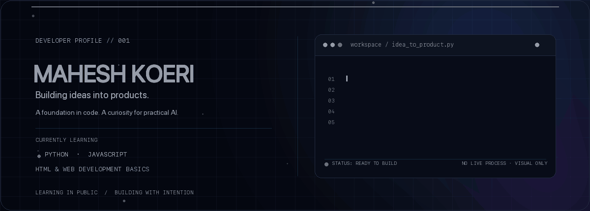
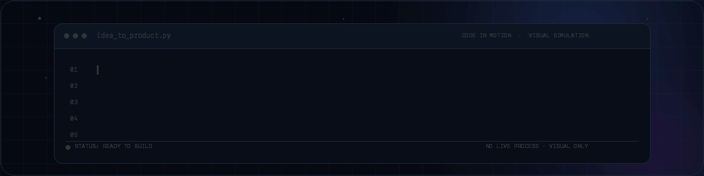

  
   
  If motion is unavailable, view the <a href="./assets/hero.svg">static hero fallback</a>.

# Mahesh Koeri

  <strong>Learning in public. Building with intention.</strong> 
  Python · JavaScript · HTML and web development basics · practical AI interests

  <a href="https://github.com/mahesh817">GitHub profile</a>
  &nbsp;·&nbsp;
  <a href="https://github.com/mahesh817?tab=repositories">Repositories</a>
  &nbsp;·&nbsp;
  <a href="https://www.linkedin.com/in/mahesh-koeri-422931430/">LinkedIn</a>

## About me

Hi, I’m Mahesh (he/him). I’m building a foundation in software development by learning Python, JavaScript fundamentals, and HTML and web development basics while practicing programming problems. I’m curious about practical AI and want to build small tools that solve real problems.

## Current focus

- Build confidence with Python and JavaScript fundamentals.
- Learn HTML and the basics of web development.
- Practice programming problems and core logic.
- Turn that learning into a first useful project.

## Tech stack

| Area | Current stage |
| --- | --- |
| Python | Learning the fundamentals |
| JavaScript | Learning the fundamentals |
| HTML and web development | Learning the basics |
| AI | Exploring practical, useful applications |

  
   
  Code in motion · visual simulation · <a href="./assets/live-coding.svg">static fallback</a>

## Featured projects

I don’t have a separate software project published yet. This repository is my profile, not a project showcase; I’ll feature work here as I build and publish it.

## GitHub statistics & activity

I use GitHub’s own contribution graph and activity feed for an up-to-date view of my profile: [view my GitHub activity](https://github.com/mahesh817).

## Hackathon achievements

I haven’t added a publicly verifiable hackathon project or achievement here yet. I’ll update this section when I have details and work to share.

## What I’m working toward

- Strengthen my Python, JavaScript, and web development basics.
- Publish small projects that solve concrete problems.
- Explore AI features when they make a product more useful.
- Learn from open-source projects and collaborate with other developers.

## Open-source collaboration

I’m interested in starting with clear documentation, beginner-friendly issues, and small improvements to practical Python and web development tools. If you maintain a project with a well-scoped first contribution, I’d be glad to learn from it.

## Contact

You can find me on [GitHub](https://github.com/mahesh817) and [LinkedIn](https://www.linkedin.com/in/mahesh-koeri-422931430/).

  Mahesh Koeri · learning, making, improving

