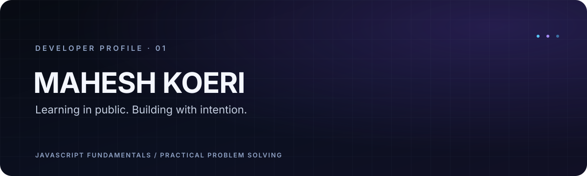

<div align="center">
  
</div>

<h1 align="center">Mahesh Koeri</h1>

<p align="center">
  <strong>Learning in public. Building with intention.</strong><br />
  JavaScript fundamentals · practical problem solving · useful products
</p>

<p align="center">
  <a href="https://github.com/mahesh817">GitHub profile</a>
  &nbsp;·&nbsp;
  <a href="https://github.com/mahesh817?tab=repositories">Repositories</a>
</p>

---

## About

Hi, I’m Mahesh (he/him). I’m building my foundation in software development, currently working through JavaScript fundamentals and programming problems. I want to turn that foundation into small, useful products and grow through projects, feedback, and collaboration.

I’m also curious about practical uses of AI: the kind that helps solve a real problem and makes a product more useful.

## Current focus

```text
mahesh@workstation ~ % focus
JavaScript fundamentals + problem-solving practice

mahesh@workstation ~ % next
Build and share a first useful project
```

## Technology map

| Area | Current focus |
| --- | --- |
| Learning | JavaScript fundamentals |
| Practicing | Programming problems and core logic |
| Exploring | Practical software products and useful AI features |

*This reflects current learning activity. No software project is available yet to verify a shipped stack.*

## Featured projects

At the time of the audit, there were no public or private project repositories to feature. This profile repository now gives the account a home, but it isn’t a software project to showcase. I’ll add project cards once there is published work to show, with a clear problem statement, the implementation, and a demo where available.

## GitHub activity

The account has a short contribution history so far. I’ve left out statistics cards and contribution animations until they can add useful context.

## Achievements & innovation

No public achievements or hackathon projects were visible in the account audit. Verified milestones can be added here as they happen.

## What I’m working toward

- Strengthen my JavaScript and problem-solving fundamentals.
- Build and publish small projects that solve concrete problems.
- Explore AI features when they make a product more helpful.
- Learn from open-source projects and collaborate with other developers.

## Open source

I’m interested in starting with clear documentation, beginner-friendly issues, and small improvements to practical JavaScript tools. If you maintain a project with a well-scoped first contribution, I’d be glad to learn from it.

## Contact

The best place to find me right now is [GitHub](https://github.com/mahesh817). I’ll add other professional links when they’re available.

<p align="center">
  <sub>Mahesh Koeri · learning, making, improving</sub>
</p>
